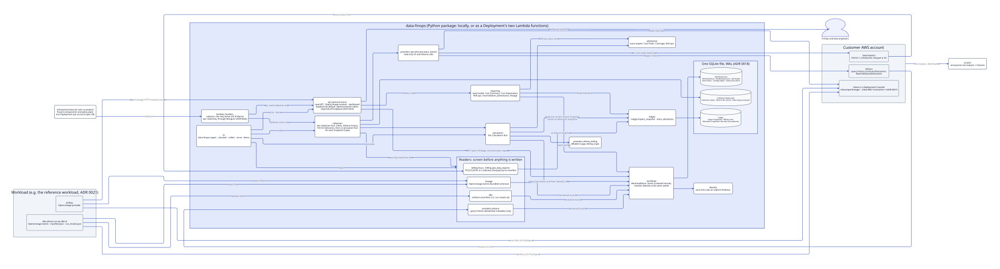
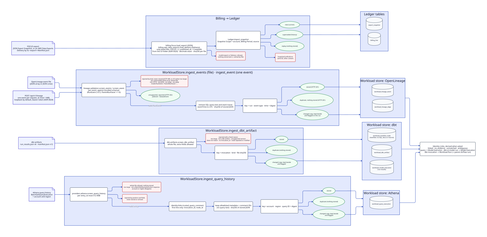
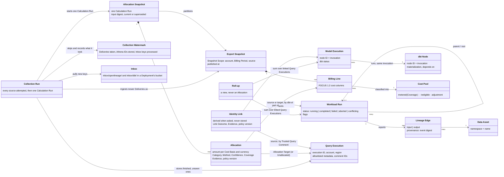
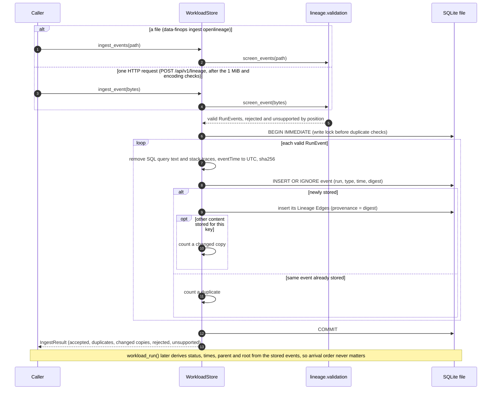
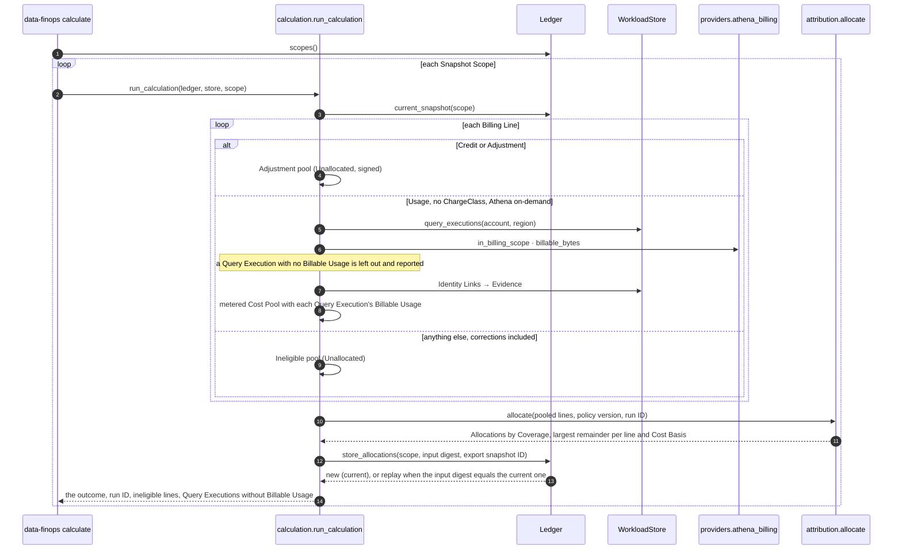
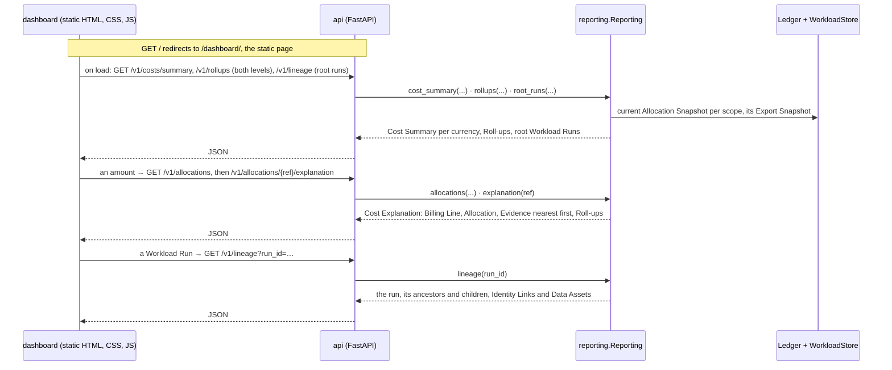
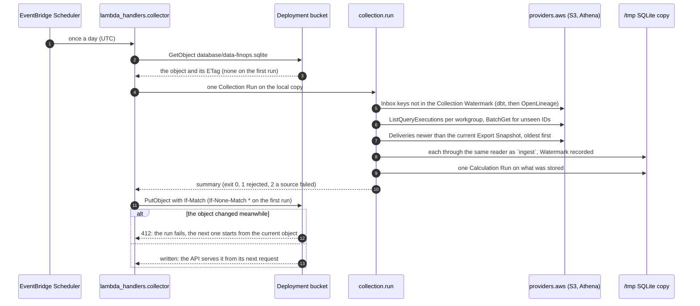
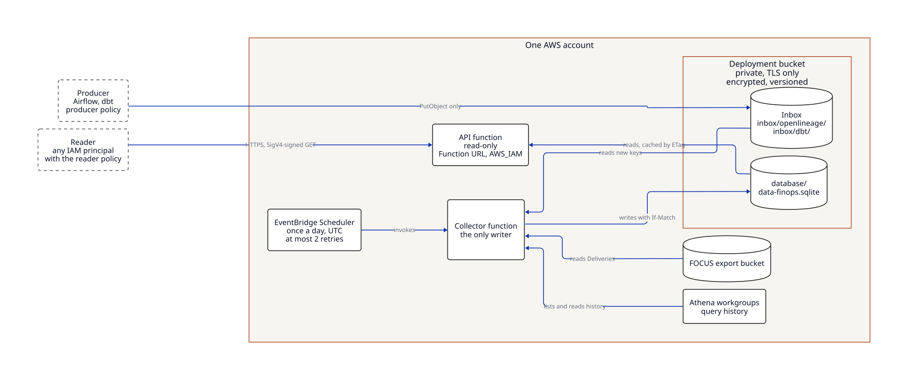
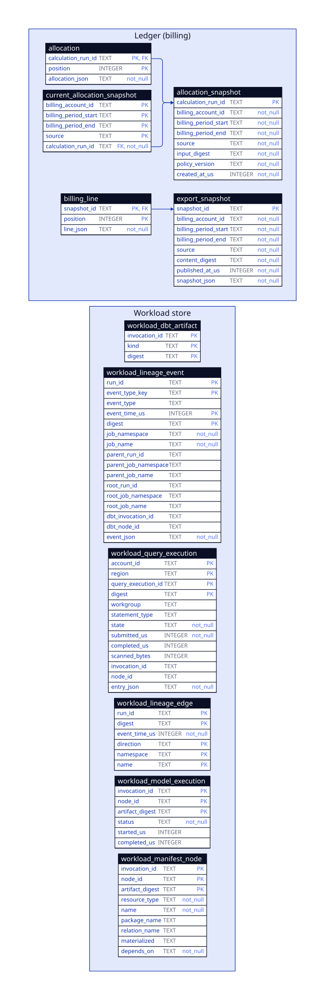

# Architecture diagrams

What M0–M6 built, drawn from the code as it stands. Terms are the ones in [`GLOSSARY.md`](../../GLOSSARY.md); decisions are in [`docs/adr/`](../adr/). Anything not built yet is drawn dashed and grey, with the milestone that brings it.

| Diagram | Answers | Tool |
|---|---|---|
| [System context](#system-context) | What feeds data-finops, what it keeps, who reads it, locally or deployed | D2 |
| [Ingest flow](#ingest-flow) | What happens to each input, and what is refused, by file or by a Collection Run | D2 |
| [Domain model](#domain-model) | How the glossary terms relate | Mermaid |
| [Event ingest sequence](#event-ingest-sequence) | One OpenLineage file, call by call | Mermaid |
| [Calculation Run](#calculation-run) | How a Snapshot Scope's bill becomes an Allocation Snapshot | Mermaid |
| [Reading the results](#reading-the-results) | How the dashboard and the API answer | Mermaid |
| [Collection Run](#collection-run) | How a Deployment's collector fetches from AWS and writes the database object | Mermaid |
| [Deployment](#deployment) | What runs in the AWS account, and across which trust boundaries | D2 (the site's) |
| [Database](#database) | Every table and column in the shared SQLite file | D2, generated |

## System context

- **Inputs:** the product reads files through `data-finops ingest`, and receives OpenLineage events one at a time over HTTP when served locally. A Collection Run (`data-finops collect`, or a Deployment's collector) fetches the same three kinds from AWS with read-only calls: FOCUS Deliveries from the export bucket, Athena history, and the files producers put in the Inbox (ADR 0027). It hands each to the same reader. Anonymized copies of real outputs become fixtures through `scripts/`.
- **Stores:** the Ledger is the only cost authority. Lineage and dbt records explain work and never carry money (ADR 0003).
- **Calculating:** `calculation` is the only module that brings the two stores together with the pure `attribution` engine and the Athena policies.
- **Reading:** `reporting` reads both stores for the API and the dashboard, through their read interfaces only (architecture-boundaries.md). Opening the Ledger may still add its newer columns to an older file.
- **Contracts:** `schemas/` holds the generated JSON Schemas for Billing Lines, Export Snapshots and Allocations, and the OpenAPI document. Tests keep each in step with the code.

## Ingest flow

Each input is checked before anything is written.

- **Billing** is all or nothing per Export Snapshot. It is read from a JSON Export Snapshot, or from an AWS Data Exports Delivery by its manifest, whose S3 folder gives `published_at` (ADR 0020 amendment). An invalid export or Delivery is refused, and a snapshot ID already stored with other content raises `SnapshotConflictError`. A restatement is a new snapshot. It becomes current and the earlier one is kept as history (ADR 0020).
- **OpenLineage** events arrive in files or one per HTTP request (`POST /api/v1/lineage`, ADR 0024) and take the same path. Files are screened event by event, so one bad event does not stop the rest of the file. The exception is a JSON array that cannot be parsed at all, which is rejected as a whole.
- **dbt** artifacts are accepted or refused as whole files.
- **Athena** query history is refused whole when it is not a BatchGetQueryExecution response, is too large, or records another account or region; otherwise it is screened entry by entry. Query text and free-text failure reasons are removed before storage.

For OpenLineage, dbt and Athena, nothing is overwritten: a second, different copy is kept next to the first and flagged (ADR 0022).

## Domain model

Identity Links (M3) connect workload records using only explicit Evidence, never time overlap (ADR 0006):

- a Query Execution to the Model Execution its Trusted Query Comment names;
- the Workload Run that dbt-ol reports for a model to that Model Execution (ADR 0022);
- a dbt invocation to the Workload Run that reported it, whose parent and root lead to the Airflow run.

Links are derived from stored observations when asked, so arrival order does not matter. Each attempt has a Link Outcome, and only `linked` makes a link: missing Evidence is `no_evidence`, Evidence naming something nobody reported is `unmatched`, and disagreeing reports are `ambiguous`.

Allocation (M4) is where billing meets the workload.
- A Calculation Run partitions every Billing Line of the current Export Snapshot into Allocations.
- A metered line is shared among the Query Executions in its billing scope by Billable Usage, as far as Coverage allows (ADR 0017).
- Everything else is Unallocated, with its reason.
- Model Executions and Workload Runs receive cost only as Roll-ups over their Identity Links (ADR 0016).

## Event ingest sequence

## Calculation Run

The engine is pure: it never touches a store, a clock or a provider policy, so the same inputs give the same Allocations. It also supports direct, shared and idle Cost Pools, but no MVP policy produces them yet, so a Calculation Run makes only metered, Ineligible and Adjustment pools. The policy version names every rule that shaped them: the engine's, line classification and both Athena policies (spec 03).

## Reading the results

Every route reads through `reporting`, which returns response models and holds no SQL. `/v1/reconciliation` and `/v1/provenance` answer the same way for API callers, and `/health` says whether the database opens. Each request opens and closes its own read connections in the thread that serves it, because SQLite refuses a connection used from another thread (found in M5's browser pass, `tests/integration/test_api_concurrency.py`). The OpenAPI 3.1 document is `schemas/openapi.json`, which a test keeps in step with the app. The dashboard follows spec 06's rules after Tufte and Few (`src/data_finops/api/dashboard/DESIGN.md`).

## Collection Run

`data-finops collect --db PATH --config FILE` runs the same Collection Run from a laptop, against a local database, with the operator's own AWS profile (spec 08). Every source is attempted even if one fails; a failed source makes the run fail after it calculates, so the scheduler's retry replays it, and replay stores nothing twice.

## Deployment

Two Lambda functions without a VPC share one SQLite file in S3: the collector is its only writer, by S3 compare-and-swap, and the API reads it behind an `AWS_IAM` Function URL (ADR 0026). The diagram is the site's, from `deployment.d2`; the site's Deployment architecture page explains the trust boundaries and the cost. The Pulumi components and the policy pack are in `infra/pulumi/aws/` (spec 08).

## Database

Generated from the schema: the Ledger and the workload store each create their tables in a temporary file, and the script reads them back from SQLite. The only declared reference is between Ledger tables. Workload records point to their source event or artifact by digest (provenance), not by foreign key.

## Regenerating

| File | After you change | Run |
|---|---|---|
| `database.d2`, `database.svg` | any table or column (a test fails until you do) | `uv run python scripts/database_diagram.py`, then `d2 --layout elk docs/architecture/database.d2 docs/architecture/database.svg` |
| `ingest-flow.svg` | `ingest-flow.d2` | `d2 --layout elk docs/architecture/ingest-flow.d2 docs/architecture/ingest-flow.svg` |
| `system-context.svg` | `system-context.d2` (the system's inputs, packages, stores or readers) | `d2 --layout elk docs/architecture/system-context.d2 docs/architecture/system-context.svg` |
| `site/assets/explanation/bill-to-roll-ups.svg` | `bill-to-roll-ups.d2` (the site's The bill is authoritative page) | `d2 --layout elk docs/architecture/bill-to-roll-ups.d2 site/assets/explanation/bill-to-roll-ups.svg` |
| `site/assets/explanation/deployment.svg` | `deployment.d2` (the site's Deployment architecture page) | `d2 --layout elk docs/architecture/deployment.d2 site/assets/explanation/deployment.svg` |
| `site/assets/explanation/coverage.svg` | `coverage.d2` (the site's Allocation and Coverage page) | `d2 --layout elk docs/architecture/coverage.d2 site/assets/explanation/coverage.svg` |
| Mermaid blocks | the glossary, the ingest path, the Calculation Run or the read path | edit this file; GitHub draws them |

Tools: D2 0.9.0 (`winget install Terrastruct.D2`). CI checks only `database.d2` against the schema, not whether the SVGs are up to date with their sources.
