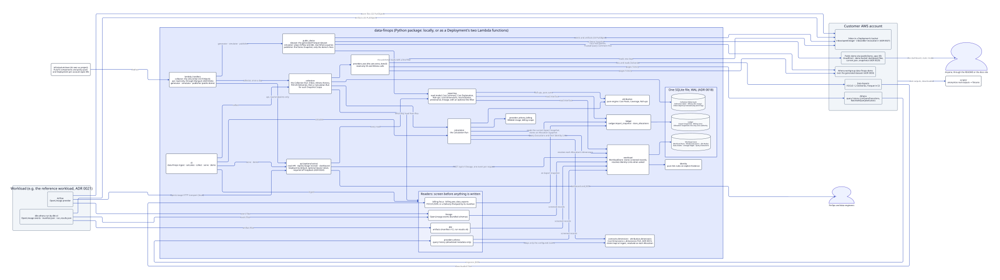
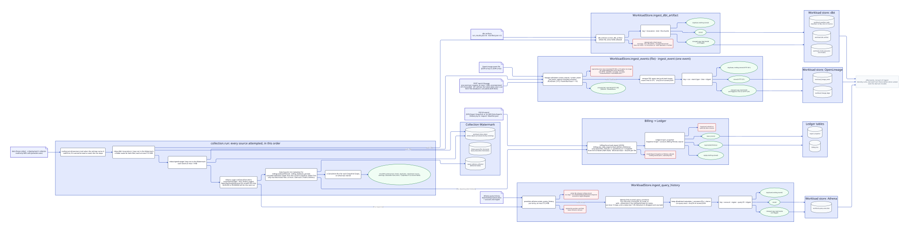
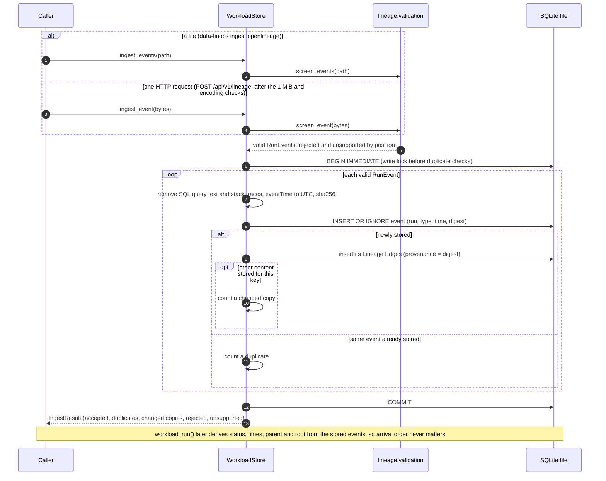
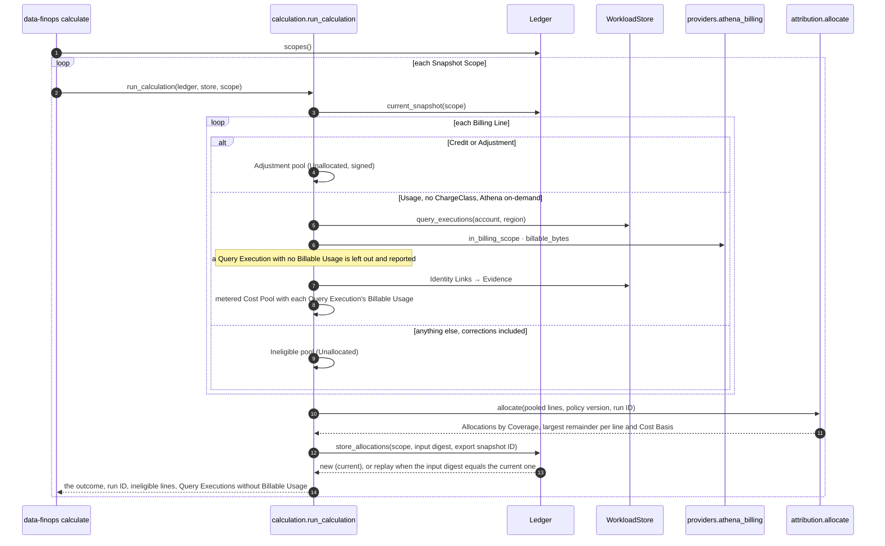
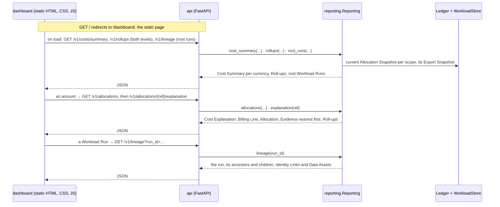
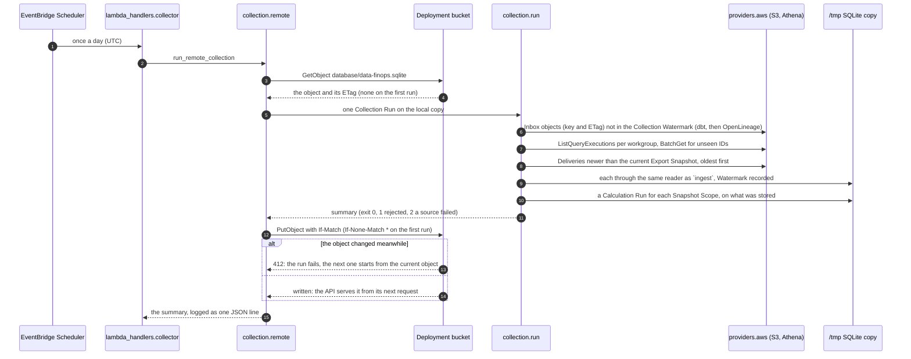
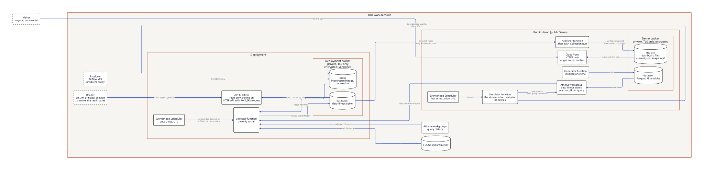
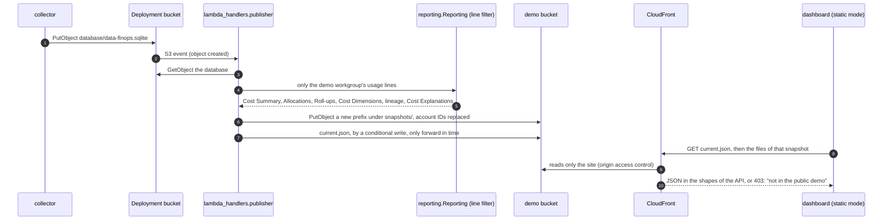
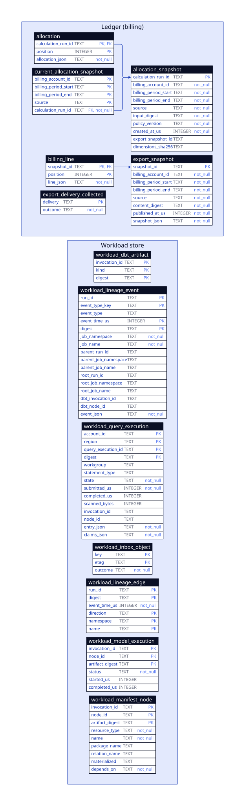

# Architecture diagrams

What M0–M7 built, drawn from the code as it stands. [`GLOSSARY.md`](../../GLOSSARY.md) defines the terms. The decisions are in [`docs/adr/`](../adr/).

| Diagram | Answers | Tool |
|---|---|---|
| [System context](#system-context) | What feeds data-finops, what it keeps, who reads it, locally or deployed | D2 |
| [Ingest flow](#ingest-flow) | What happens to each input, and what is refused, by file or by a Collection Run | D2 |
| [Domain model](#domain-model) | How the glossary terms relate | Mermaid |
| [Event ingest sequence](#event-ingest-sequence) | One OpenLineage file, call by call | Mermaid |
| [Calculation Run](#calculation-run) | How a Snapshot Scope's bill becomes an Allocation Snapshot | Mermaid |
| [How the results are read](#how-the-results-are-read) | How the dashboard and the API answer | Mermaid |
| [Collection Run](#collection-run) | How a Deployment's collector fetches from AWS and writes the database object | Mermaid |
| [Cost Dimensions and the Public Demo](#cost-dimensions-and-the-public-demo) | How a configured dimension reaches an Allocation, and how a Demo Snapshot is published and read | Mermaid |
| [Deployment](#deployment) | What runs in the AWS account, and across which trust boundaries, with the optional Public Demo | D2 (the site's) |
| [Database](#database) | Every table and column in the shared SQLite file | D2, generated |

## System context

- **Inputs:** the product reads files through `data-finops ingest`, and receives OpenLineage events one at a time over HTTP when served locally. A Collection Run (`data-finops collect`, or a Deployment's collector) fetches the same three kinds from AWS with read-only calls: FOCUS Deliveries from the export bucket, Athena history, and the files producers put in the Inbox (ADR 0027). It hands each to the same reader. Anonymized copies of real outputs become fixtures through `scripts/`.
- **Stores:** the Ledger is the only cost authority. Lineage and dbt records explain work and never carry money (ADR 0003).
- **Calculation:** `calculation` is the only module that brings the two stores together with the pure `attribution` engine and the Athena policies.
- **Reads:** `reporting` reads both stores for the API and the dashboard, only through their read interfaces (architecture-boundaries.md). When the Ledger opens an older file, it can still add its newer columns to that file.
- **Cost Dimensions and the Public Demo (M7):** ingest keeps the configured claims, and each Calculation Run records the dimensions on each Allocation. The `public_demo` package runs the demo's workload and publishes its Demo Snapshot. See [Cost Dimensions and the Public Demo](#cost-dimensions-and-the-public-demo).
- **Contracts:** `schemas/` holds the generated JSON Schemas for Billing Lines, Export Snapshots and Allocations, and the OpenAPI document. Tests keep each in step with the code.

## Ingest flow

Each input is checked before anything is written.

- **Billing** is all or nothing per Export Snapshot. It is read from a JSON Export Snapshot, or from an AWS Data Exports Delivery by its manifest, whose S3 folder gives `published_at` (ADR 0020 amendment). An invalid export or Delivery is refused, and a snapshot ID already stored with other content raises `SnapshotConflictError`. A restatement is a new snapshot. It becomes current and the earlier one is kept as history (ADR 0020).
- **OpenLineage** events arrive in files or one per HTTP request (`POST /api/v1/lineage`, ADR 0024) and take the same path. Files are screened event by event, so one bad event does not stop the rest of the file. The exception is a JSON array that cannot be parsed at all, which is rejected as a whole.
- **dbt** artifacts are accepted or refused as whole files.
- **Athena** query history is refused as a whole in three cases: it is not a BatchGetQueryExecution response, it is too large, or it records a different account or Region. If not, each entry is screened. Query text and free-text failure reasons are removed before storage.

For OpenLineage, dbt and Athena, nothing is overwritten: a second, different copy is kept next to the first and flagged (ADR 0022).

## Domain model

```mermaid
classDiagram
    direction LR
    class ExportSnapshot["Export Snapshot"] {
        Snapshot Scope: account, Billing Period, source
        published at
    }
    class BillingLine["Billing Line"] {
        FOCUS 1.2 cost columns
    }
    class WorkloadRun["Workload Run"] {
        status: running | completed | failed | aborted | conflicting
        flags
    }
    class DataAsset["Data Asset"] {
        namespace + name
    }
    class LineageEdge["Lineage Edge"] {
        input | output
        provenance: event digest
    }
    class ModelExecution["Model Execution"] {
        node ID + invocation
        dbt status
    }
    class DbtNode["dbt Node"] {
        node ID + invocation
        materialization, depends on
    }
    class QueryExecution["Query Execution"] {
        execution ID, account, region
        allowlisted metadata, comment IDs
    }
    class IdentityLink["Identity Link"] {
        derived when asked, never stored
        Link Outcome, Evidence, policy version
    }
    class Allocation {
        amount per Cost Basis and currency
        Category, Method, Confidence, Coverage
        Evidence, policy version
    }
    class AllocationSnapshot["Allocation Snapshot"] {
        one Calculation Run
        input digest, current or superseded
    }
    class CostPool["Cost Pool"] {
        metered (Coverage) · ineligible · adjustment
    }
    class RollUp["Roll-up"] {
        a view, never an Allocation
    }
    class CollectionRun["Collection Run"] {
        every source attempted, then a Calculation Run per Snapshot Scope
    }
    class CollectionWatermark["Collection Watermark"] {
        Deliveries taken, Athena IDs stored, Inbox objects by key and ETag
    }
    class Inbox {
        inbox/openlineage/ and inbox/dbt/ in a Deployment's bucket
    }
    class CostDimension["Cost Dimension"] {
        configured sources, first value wins
        value + source, or unassigned
    }
    class DemoSnapshot["Demo Snapshot"] {
        the demo's lines only, account IDs replaced
        swapped in whole through current.json
    }

    ExportSnapshot "1" *-- "many" BillingLine
    WorkloadRun "0..1" <-- "many" WorkloadRun : parent / root
    WorkloadRun "1" --> "many" LineageEdge : reports
    LineageEdge "many" --> "1" DataAsset
    ModelExecution "many" --> "1" DbtNode : runs, same invocation
    IdentityLink --> QueryExecution : source, by Trusted Query Comment
    IdentityLink --> WorkloadRun : source or target, by dbt-ol facets
    IdentityLink --> ModelExecution : target
    AllocationSnapshot "1" *-- "many" Allocation
    AllocationSnapshot --> ExportSnapshot : partitions
    BillingLine "many" --> "1" CostPool : classified into
    Allocation --> BillingLine : part of
    Allocation --> QueryExecution : Allocation Target (or Unallocated)
    RollUp --> ModelExecution : sum over linked Query Executions
    RollUp --> WorkloadRun : sum over linked Query Executions
    CollectionRun --> Inbox : pulls new keys
    CollectionRun --> CollectionWatermark : skips and records what it took
    CollectionRun --> ExportSnapshot : ingests newer Deliveries as
    CollectionRun --> QueryExecution : stores finished, unseen ones
    CollectionRun --> AllocationSnapshot : a Calculation Run per Snapshot Scope
    QueryExecution --> CostDimension : claims from the query comment
    Allocation --> CostDimension : records value and source, a view
    DemoSnapshot --> AllocationSnapshot : published from the current one
```

Identity Links (M3) connect workload records with only explicit Evidence, never with time overlap (ADR 0006):

- a Query Execution to the Model Execution that its Trusted Query Comment names
- the Workload Run that dbt-ol reports for a model to that Model Execution (ADR 0022)
- a dbt invocation to the Workload Run that reported it, whose parent and root lead to the Airflow run.

Links are derived from stored observations when asked, so arrival order does not matter. Each attempt has a Link Outcome, and only `linked` makes a link. No Evidence gives `no_evidence`. Evidence that names something that nobody reported gives `unmatched`. Reports that disagree give `ambiguous`.

Allocation (M4) is where billing meets the workload.
- A Calculation Run partitions every Billing Line of the current Export Snapshot into Allocations.
- A metered line is shared among the Query Executions in its billing scope by Billable Usage, as far as Coverage allows (ADR 0017).
- Everything else is Unallocated, with its reason.
- Model Executions and Workload Runs receive cost only as Roll-ups over their Identity Links (ADR 0016).

## Event ingest sequence

## Calculation Run

The engine is pure: it never touches a store, a clock or a provider policy, so the same inputs give the same Allocations. It also supports direct, shared and idle Cost Pools, but no MVP policy produces them yet, so a Calculation Run makes only metered, Ineligible and Adjustment pools. The policy version names every rule that shaped them: the engine's, line classification and both Athena policies (spec 03).

## How the results are read

Every route reads through `reporting`, which returns response models and holds no SQL. `/v1/reconciliation` and `/v1/provenance` answer the same way for API callers, and `/health` says whether the database opens. Each request opens and closes its own read connections in the thread that serves it, because SQLite refuses a connection used from another thread (found in M5's browser pass, `tests/integration/test_api_concurrency.py`). The OpenAPI 3.1 document is `schemas/openapi.json`, which a test keeps in step with the app. The dashboard follows spec 06's rules after Tufte and Few (`src/data_finops/api/dashboard/DESIGN.md`).

## Collection Run

`data-finops collect --db PATH --config FILE` runs the same Collection Run from a laptop, against a local database, with the operator's own AWS profile (spec 08). Each source is tried, even if one fails. A failed source makes the run fail after it calculates. Thus the scheduler retries the run, and the replay stores nothing two times.

## Deployment

Two Lambda functions without a VPC share one SQLite file in S3: the collector is its only writer, by S3 compare-and-swap. The API reads it behind an `AWS_IAM` Function URL (ADR 0026). The diagram is the diagram of the site, from `deployment.d2`. The Deployment architecture page of the site explains the trust boundaries and the cost. The Pulumi components and the policy pack are in `infra/pulumi/aws/` (spec 08).

## Cost Dimensions and the Public Demo

**Cost Dimensions (M7, ADR 0031).** An organization declares the attributes that it groups cost by, such as team or tenant, in one TOML file (`--dimensions FILE`, or a Deployment's `costDimensions`).
- **Capture:** `ingest athena` keeps only the comment keys that the file names, as the `claims` of each Query Execution. There are 16 keys at most, and a value over 128 characters is dropped and counted.
- **Resolution:** each Calculation Run resolves each dimension from its sources in order: a query comment key, an OpenLineage tag of the linked Workload Run and its parents, or a workgroup map. It records the value and the source on each Allocation. Cost with no value is unassigned.
- **A view only:** a dimension never changes how a Billing Line is split, and a claim is never Evidence. Thus the total of each dimension equals the total of the snapshot.
- **Forward only:** the SHA-256 of the file is recorded on the Allocation Snapshot, but it is not part of the input digest. A changed file applies from the next snapshot that new inputs make.

**The Public Demo (M7, ADRs 0029 and 0030, spec 09).** An optional part of a Deployment (`publicDemo`). The right side of the [Deployment](#deployment) diagram shows it.
- **The workload:** `public_demo.simulator` plays Airflow and dbt. It runs real queries in the `data-finops-demo` workgroup over the dataset that `public_demo.dataset` generated, and writes OpenLineage events and dbt artifacts to the Inbox. The collector reads them as any producer's.
- **The site:** after each Collection Run, `public_demo.publisher` writes a Demo Snapshot: the read model's answers, as files in the shapes of the API. The read model gets a line filter, so that only the demo workgroup's usage lines and what comes from them are published. CloudFront serves the snapshot and the dashboard, which reads the files in its static mode (`static.js`).

## Database

Generated from the schema: the Ledger and the workload store each create their tables in a temporary file. Then the script reads them back from SQLite. The only declared reference is between Ledger tables. Workload records point to their source event or artifact by digest (provenance), not by foreign key.

## Generate the diagrams again

| File | After you change | Run |
|---|---|---|
| `database.d2`, `database.svg` | any table or column (a test fails until you do) | `uv run python scripts/database_diagram.py`, then `d2 --layout elk docs/architecture/database.d2 docs/architecture/database.svg` |
| `ingest-flow.svg` | `ingest-flow.d2` | `d2 --layout elk docs/architecture/ingest-flow.d2 docs/architecture/ingest-flow.svg` |
| `system-context.svg` | `system-context.d2` (the system's inputs, packages, stores or readers) | `d2 --layout elk docs/architecture/system-context.d2 docs/architecture/system-context.svg` |
| `site/assets/explanation/bill-to-roll-ups.svg` | `bill-to-roll-ups.d2` (the site's The bill is authoritative page) | `d2 --layout elk docs/architecture/bill-to-roll-ups.d2 site/assets/explanation/bill-to-roll-ups.svg` |
| `site/assets/explanation/deployment.svg` | `deployment.d2` (the site's Deployment architecture and Public Demo pages) | `d2 --layout elk docs/architecture/deployment.d2 site/assets/explanation/deployment.svg` |
| `site/assets/explanation/coverage.svg` | `coverage.d2` (the site's Allocation and Coverage page) | `d2 --layout elk docs/architecture/coverage.d2 site/assets/explanation/coverage.svg` |
| Mermaid blocks | the glossary, the ingest path, the Calculation Run or the read path | Edit this file. GitHub draws them. |

Tools: D2 0.9.0 (`winget install Terrastruct.D2`). CI checks only `database.d2` against the schema, not whether the SVGs are up to date with their sources.
