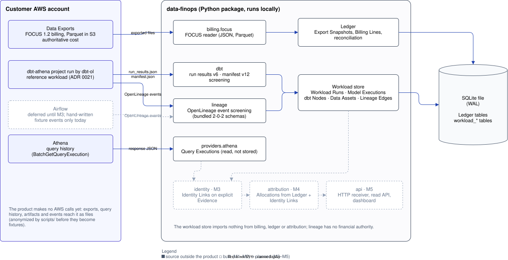
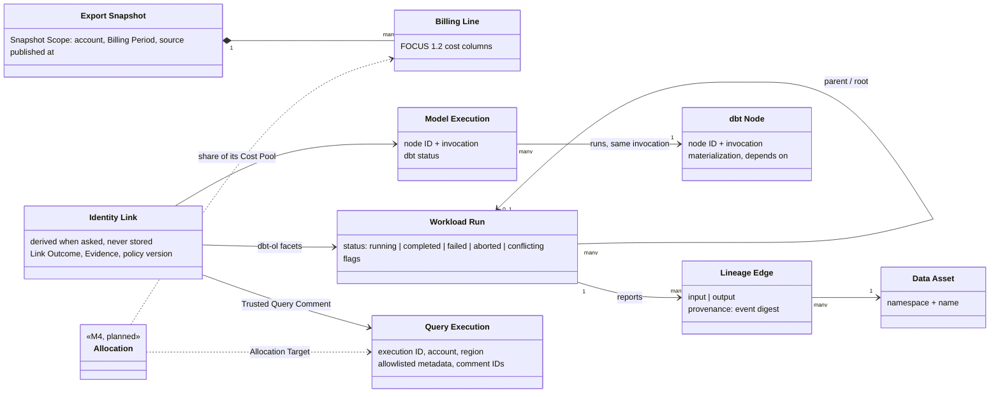
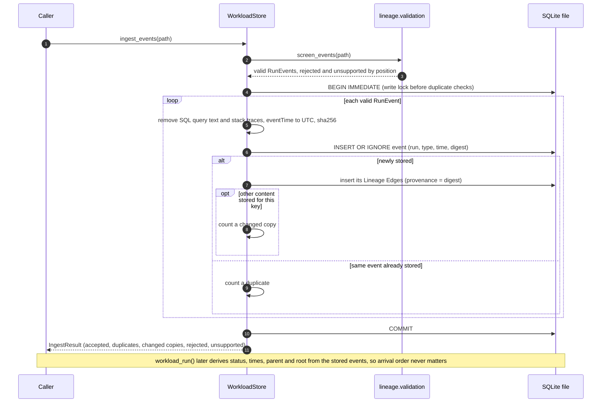

# Architecture diagrams

What M0–M3 built, drawn from the code as it stands. Terms are the ones in [`GLOSSARY.md`](../../GLOSSARY.md); decisions are in [`docs/adr/`](../adr/). Anything not built yet is drawn dashed and grey, with the milestone that brings it.

| Diagram | Answers | Tool |
|---|---|---|
| [System context](#system-context) | What feeds data-finops, what it keeps, what comes next | draw.io |
| [Ingest flow](#ingest-flow) | What happens to each input, and what is refused | D2 |
| [Domain model](#domain-model) | How the glossary terms relate | Mermaid |
| [Event ingest sequence](#event-ingest-sequence) | One OpenLineage file, call by call | Mermaid |
| [Database](#database) | Every table and column in the shared SQLite file | D2, generated |

## System context

The product reads files today. It makes no AWS calls, and anonymized copies of real outputs become fixtures through `scripts/`. The Ledger is the only cost authority. Lineage and dbt records explain work and never carry money (ADR 0003).

## Ingest flow

Each input is checked before anything is written.

- **Billing** is all or nothing per Export Snapshot: an invalid export raises a validation error, and a snapshot ID already stored with other content raises `SnapshotConflictError`. A restatement is a new snapshot. It becomes current and the earlier one is kept as history (ADR 0020).
- **OpenLineage** files are screened event by event, so one bad event does not stop the rest of the file. The exception is a JSON array that cannot be parsed at all, which is rejected as a whole.
- **dbt** artifacts are accepted or refused as whole files.
- **Athena** query history is refused whole when it is not a BatchGetQueryExecution response, is too large, or records another account or region; otherwise it is screened entry by entry. Query text and free-text failure reasons are removed before storage.

For OpenLineage, dbt and Athena, nothing is overwritten: a second, different copy is kept next to the first and flagged (ADR 0022).

## Domain model

Identity Links (M3) connect workload records using only explicit Evidence, never time overlap (ADR 0006):

- a Query Execution to the Model Execution its Trusted Query Comment names;
- a dbt-ol model run to the Model Execution it reports (ADR 0022);
- a dbt invocation to the Workload Run that reported it, whose parent and root lead to the Airflow run.

Links are derived from stored observations when asked, so arrival order does not matter. Each attempt has a Link Outcome, and only `linked` makes a link: missing Evidence is `no_evidence`, Evidence naming something nobody reported is `unmatched`, and disagreeing reports are `ambiguous`.

There are still no links between billing records and workload records. Allocation (M4) will assign shares of Billing Lines' Cost Pools to Query Executions, and Model Executions and Workload Runs then receive cost only as Roll-ups over their Identity Links.

## Event ingest sequence

## Database

Generated from the schema: the Ledger and the workload store each create their tables in a temporary file, and the script reads them back from SQLite. The only declared reference is between Ledger tables. Workload records point to their source event or artifact by digest (provenance), not by foreign key.

## Regenerating

| File | After you change | Run |
|---|---|---|
| `database.d2`, `database.svg` | any table or column (a test fails until you do) | `uv run python scripts/database_diagram.py`, then `d2 --layout elk docs/architecture/database.d2 docs/architecture/database.svg` |
| `ingest-flow.svg` | `ingest-flow.d2` | `d2 --layout elk docs/architecture/ingest-flow.d2 docs/architecture/ingest-flow.svg` |
| `system-context.drawio.svg` | the system's inputs, packages or stores | open it in draw.io (desktop, or the VS Code draw.io extension) and save; the file stays an SVG |
| Mermaid blocks | the glossary or the ingest path | edit this file; GitHub draws them |

Tools: D2 0.9.0 (`winget install Terrastruct.D2`), draw.io desktop 32.6.1 (`winget install JGraph.Draw`) or the `hediet.vscode-drawio` extension. CI checks only `database.d2` against the schema, not whether the SVGs are up to date with their sources.
